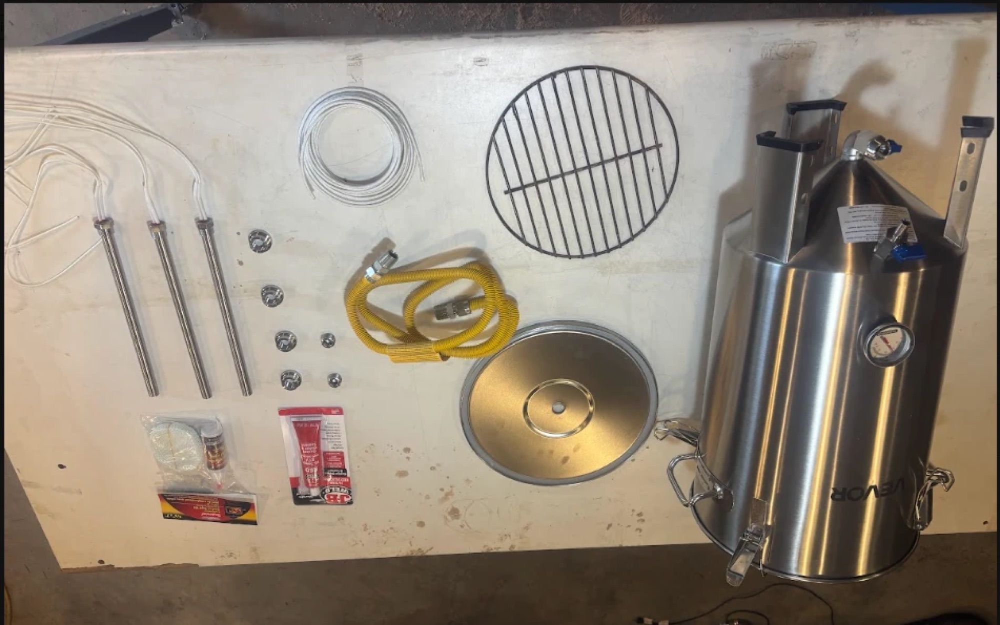

# Design

## How it works

1. **Collect.** The vessel sits in a small outhouse under a closing seat; nobody sits on the vessel itself. Liquid drains from the bottom of the cone into a sealed container, with a P-trap in between to block smell.
2. **Dry.** While it fills over a couple of days, a small 12 V blower pushes air in through the cone-side bung, up through the wet material, and out the lid bung. The blower is 12 V so it can run directly off a small solar panel whenever the sun is out. This won't remove all the water, but the heaters have much less steam to drive off.
3. **Cook.** For a firing, the blower comes off and the lid bung is plugged. Two 750 W cartridge heaters, standing up from a grate at the top of the cone, heat the insulated vessel to about 550–570 °F and hold it there as long as practical. Steam and gas leave through the cone-side bung, the same bung the heater wires exit, along the 3/4" gas hose to a point away from the tank.
4. **Empty.** The result is dry, sterile, lightweight torrefied char.

At torrefaction temperatures the outlet may turn out to be just a steam vent. If it gives off flammable gas, the plan is to run it through a bubbler to condense out the last of the moisture, then capture the gas.

### Torrefaction in brief

Torrefaction is mild roasting of organic matter with little oxygen, usually at about **200–300 °C (390–570 °F)**. It drives off water and some light gases, kills pathogens, and turns the material brittle, water-resistant and more energy-dense per kilo. It keeps most of its volatiles, so it releases far less wood gas than full pyrolysis (biochar), which typically runs at 350–700 °C (660–1300 °F).

The target here, **about 570 °F (300 °C)**, sits at the top of the torrefaction range.

### Key choices

- **Brewing fermenter as the vessel.** Cheap, stainless, sealable lid with latches, and a conical bottom that drains to a valve. The same design comes in 16 gal for about $40 more, so it can scale.
- **1/2" NPT weld-on bungs everywhere.** Every port uses the same thread, so heaters, the blower, plugs and future gas fittings can be swapped around.
- **Cartridge heaters, not water-heater elements.** Water-heater elements burn out without water around them. Cartridge heaters ("hot rods") tolerate running dry inside packed material, as long as they can shed heat. They screw straight into the bungs. <!-- TODO(Charlie): confirm the DERNORD listing is rated for dry use. -->
- **Large gas hose as a cable conduit.** A 3/4" ID (1" OD) flexible gas line is big enough to carry the heater wiring out of the vessel. It also lets wires and gas split at a junction later.
- **Ceramic-fiber blanket** around the vessel to reach and hold temperature.

## Ports

| Port | Original fitting | Now | Used for |
|---|---|---|---|
| Lid center | Airlock / bubbler | 1/2" NPT bung | Drying-air outlet while filling; plugged during a firing |
| Cone side | Small secondary drain | 1/2" NPT bung, with a drip hood inside | Heater wires out at all times. While filling, blower air comes in here. During a firing, steam and gas go out through the gas hose. |
| Cone bottom | Main drain valve | Unchanged | Liquid drain, through a P-trap to a sealed container |
| Side gauge | Thermometer | Swapped for a 400 °F dial (not enough for firing) | Rough reading. A thermocouple thermometer is on order. |

## Electrical

- 2 × DERNORD 120 V 750 W cartridge heaters, **wired in parallel**. One lead from each heater is spliced to each conductor of a 12 AWG mica (glass-fiber) high-temperature wire, and the splices are covered in heat shrink.
- Total about 1500 W, or about 12.5 A at 120 V, run from a standard 15 A outlet.
- The mica leads exit through the cone-side bung and run inside the gas hose to a standard 120 V plug. The heat-shrunk splices stay outside the hot zone; the heat shrink is rated to 125 °C.
- **Control, for now:** none. The heaters are simply on, and temperature is watched on a thermometer. The goal is as few electronics as possible. A PID controller is a possible later addition if it turns out to be needed.
- The 12 V blower is on its own small solar panel, separate from the heater circuit.

!!! warning "Continuous load"
    Two 750 W heaters draw about 12.5 A. Electrical code treats anything running 3 hours or more as a *continuous* load and limits it to 80% of the breaker rating, which is 12 A on a 15 A circuit. A long firing on a 15 A outlet is just over that limit. Options:

    - Run it on a **20 A circuit** (16 A continuous), with a 12 AWG cord.
    - **Lower the wattage**, for example two 600 W heaters (10 A).
    - Use a heavy cord either way. Thin 16 AWG extension cords are rated about 13 A and will run hot.

    A thermostat that cycles the heaters reduces average heat but not the current drawn while they're on, so it doesn't fix this by itself.

!!! note "Always open"
    The vessel is never sealed while heating. Steam and gas always have a path out through the cone-side bung and gas hose. Keep that outlet clear.

## Parts

The parts I bought cost about $385. The grill grate was salvaged.

{{ parts_list }}

## Files

<!-- No CAD yet. A sketch of the port layout and wiring, photographed, would be perfect here. -->

{{ files_list }}
