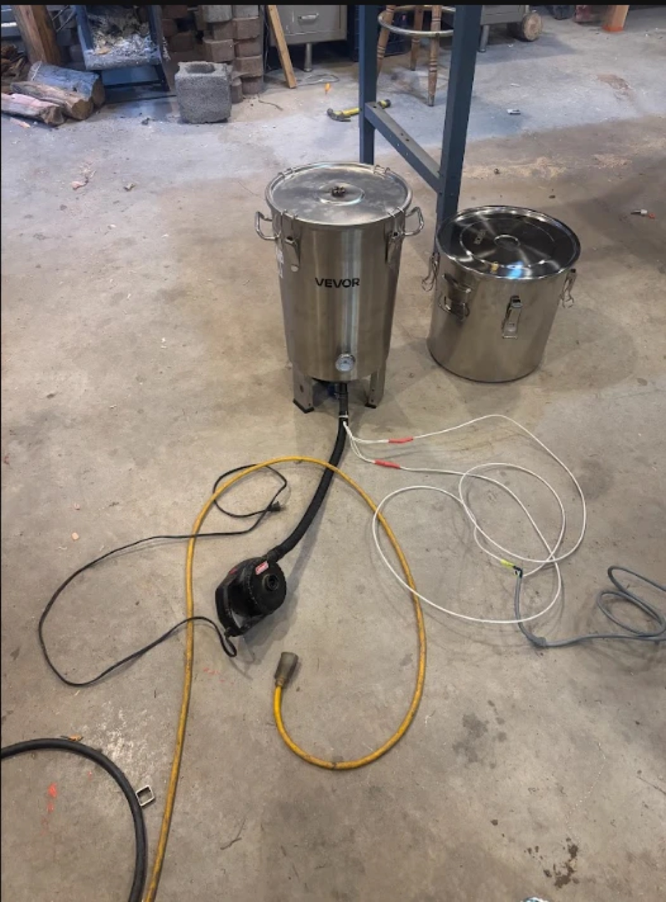

# Electric Biochar Toilet

**Status:** Prototype

**Maker:** Charlie Britton · Mars College Dept of Makers, 2027

## Documentation

- [Design](design.md)
- [Project Log](log.md)
- [Build It Yourself](build-it.md)

A small electric cooker that turns human and organic waste into **torrefied char**: dry, sterile, lightweight and stable. It's built from cheap, off-the-shelf parts around an 8-gallon stainless brewing fermenter.

**Who it's for:** seasonal off-grid camps like Mars College. These camps have plenty of solar power, run for about three months a year, and currently pay for porta-potties.

## Why

The usual off-grid options for human waste are composting toilets, biodigesters and humanure systems. They all need lots of water, lots of time, or both. That's a poor fit for a camp that packs up after three months. The result is half-composted or half-digested waste to deal with at the end. Keeping a compost pile moist through the summer isn't feasible either. Digging deep holes goes against the camp's leave-no-trace goal.

Cooking the waste solves several of these at once:

- **Sterilizes it**, so pathogens stop being a concern.
- **Makes it light and inert**, so it's easy to store, move or bury.
- **Uses power we already have plenty of** (solar) instead of water or time.
- **Can take other waste too**, such as cardboard and organic scraps.
- **Opens up uses:** a carbon-sequestering soil amendment, a future source of wood gas for the kitchen, and the builder's main interest, **fuel for firing ceramics in a rocket kiln**.

## Why torrefaction, not full pyrolysis

Torrefaction is a gentler step than full pyrolysis. The material dries, sterilizes and starts to carbonize, but keeps most of its volatile gases. For kiln fuel that's a plus: torrefied material burns longer and with more energy than plain dried biomass. Leaving the volatiles in may also affect the ceramics in interesting ways.

The lower temperature also makes the machine much simpler. Oven-range heat lets you use ordinary cartridge heaters, thin stainless, stove gaskets and standard 120 V wiring. → [How it works](design.md)

## Status

**First draft, mid-build.** The vessel is modified, the heaters are installed and wired, and a short dry test heated up fine. Insulation, the gas outlet, a thermocouple, and a first firing with real material are still to come. See the [Log](log.md).
