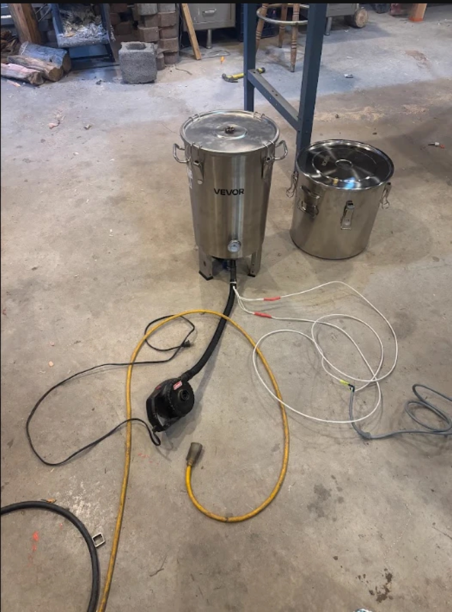

# Log

### 2026-11-02 · Build to first checkpoint

Got the vessel to a working checkpoint:

- Replaced the lid's silicone gasket with a wood-stove gasket (two layers of thin ribbon). I clamped the lid shut while the cement was wet so the gasket set to the rim's shape.
- Welded two 1/2" NPT bungs into an old grill grate that sits at the top of the cone, and screwed the two 750 W cartridge heaters into them.
- Swapped the cone's side drain and the lid's bubbler for welded 1/2" NPT bungs. The welds are ugly (thick bung, thin tank) but hold. They'll get high-heat caulk.
- Bent a small hood over the inside of the side bung so liquid runs past it to the main drain.
- Fed the heater leads out the side bung and spliced them in parallel onto 12 AWG mica wire.

Ran a short dry test with the vessel empty: both heaters came up to heat. No organic material has gone in yet.

Next: insulation, the gas hose and wire/gas junction off the side bung, a thermocouple thermometer (ordered), and a first firing with material in it.

### 2026-10-27 · Parts ordered

Ordered the fermenter, heaters, bungs, plugs, mica wire, insulation blanket and blower. The gas hose came on 11-02. See the [parts list](design.md#parts).
